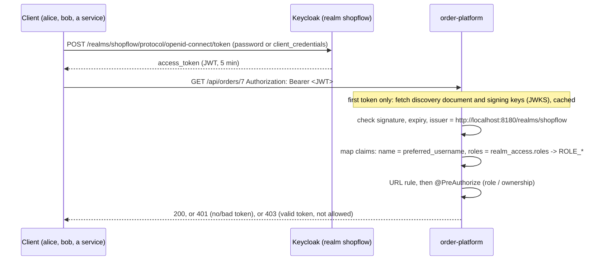

# order-platform notes

Findings from working on this module, with the examples and numbers behind them.

- [Jackson 3 in Spring Boot 4.1](#jackson-3-in-spring-boot-41)
- [Lazy connection fetching](#lazy-connection-fetching)
- [Virtual threads: when they help and when they don't](#virtual-threads-when-they-help-and-when-they-dont)
- [Kafka consumer groups and share groups](#kafka-consumer-groups-and-share-groups)
- [Delivery guarantees: at-least-once vs. exactly-once](#delivery-guarantees-at-least-once-vs-exactly-once)
- [Security: roles, token flow and ownership rules](#security-roles-token-flow-and-ownership-rules)

Versions: Spring Boot 4.1.2, Spring Framework 7.0.10, Jackson 3.1.7, Hibernate 7.4.13, Java 25.

---

## Jackson 3 in Spring Boot 4.1

### Packages

Jackson 3 moved the core and databind classes to a new package root. The annotations did not move.

| What | Package | Artifact (this project) |
|---|---|---|
| `JsonMapper`, `ObjectMapper`, databind | `tools.jackson.databind` | `tools.jackson.core:jackson-databind` 3.1.7 |
| Streaming (`StreamReadFeature`, `StreamWriteFeature`) | `tools.jackson.core` | `tools.jackson.core:jackson-core` 3.1.7 |
| Annotations (`@JsonProperty`, `@JsonIgnore`, ...) | **`com.fasterxml.jackson.annotation`** (unchanged) | `com.fasterxml.jackson.core:jackson-annotations` 2.21 |

This is what `./mvnw dependency:tree` shows. All of it arrives through
`spring-boot-starter-jackson`. The project's own code imports no Jackson classes at all: Spring MVC
does the serialization.

```java
import com.fasterxml.jackson.annotation.JsonProperty;   // annotations: still com.fasterxml
import tools.jackson.databind.json.JsonMapper;          // everything else: tools.jackson
```

`JsonMapper` is injectable as a bean, which was handy for checking output in tests:

```java
@Autowired JsonMapper mapper;

mapper.writeValueAsString(new BigDecimal("1E+3"));   // "1000" with the settings below
```

### Configuring features with properties, not mapper beans

Boot 4.1 binds feature switches straight from `spring.jackson.*`. The prefix decides which Jackson
enum the keys come from:

| Property prefix | Jackson enum | Examples of keys |
|---|---|---|
| `spring.jackson.read.*` | `StreamReadFeature` | `strict-duplicate-detection`, `ignore-undefined`, `use-fast-double-parser`, `include-source-in-location`, `auto-close-source` |
| `spring.jackson.write.*` | `StreamWriteFeature` | `write-bigdecimal-as-plain`, `ignore-unknown`, `use-fast-double-writer`, `auto-close-target`, `flush-passed-to-stream` |
| `spring.jackson.json.read.*` / `.write.*` | `JsonReadFeature` / `JsonWriteFeature` | JSON-syntax options |
| `spring.jackson.deserialization.*` | `DeserializationFeature` | databind-level reading |
| `spring.jackson.serialization.*` | `SerializationFeature` | databind-level writing |
| `spring.jackson.datatype.datetime.*` | `DateTimeFeature` | date and time handling |
| `spring.jackson.mapper.*` | `MapperFeature` | mapper behaviour |

Other single-value keys exist too: `default-property-inclusion`, `property-naming-strategy`,
`time-zone`, `locale`, `date-format`, `default-leniency`, `use-jackson2-defaults`.

The enum names come from the jars (`javap` on `jackson-core-3.1.7`), and the property keys from the
`spring-boot-jackson` configuration metadata. Enum constants are written in kebab case.

What this module sets (`application.yaml`):

```yaml
spring:
  jackson:
    read:
      strict-duplicate-detection: true   # reject {"a":1,"a":2} instead of letting the last value win
    write:
      write-bigdecimal-as-plain: true    # money is written as 1000, never 1E+3
```

#### Measured effect (same app, each setting off and then on)

| Check | Setting off | Setting on |
|---|---|---|
| `BigDecimal("1E+3")` written by the mapper | `1E+3` | `1000` |
| `POST /api/orders` with `"customerId"` given twice | `201`, the last value silently wins | `400` problem detail |
| A normal `POST` | `201` | `201` |

The duplicate-key request:

```json
{ "customerId": "a", "customerId": "b",
  "lines": [ { "sku": "A", "quantity": 1, "unitPrice": 1 } ] }
```

With the feature on, the response is the same generic body as any unreadable request. The message
does not say that a key was duplicated:

```json
{"detail":"Failed to read request","instance":"/api/orders","status":400,"title":"Bad Request"}
```

### Examples of what Jackson produces in this module

Dates are ISO-8601 strings (`Instant`, `LocalDate`) and `BigDecimal` keeps its scale.

A version 2 order (`GET /api/orders/{id}`):

```json
{"id":2,"customerId":"c-v2","discountCode":"WELCOME","createdAt":"2026-11-12T11:15:32.373597Z",
 "status":"PENDING_PAYMENT",
 "lines":[{"sku":"A","quantity":2,"unitPrice":10.50,"lineTotal":21.00},
          {"sku":"B","quantity":1,"unitPrice":3.25,"lineTotal":3.25}],
 "totals":{"lineCount":2,"unitCount":3,"amount":24.25}}
```

A page. This needs `spring.data.web.pageable.serialization-mode: via-dto`. Without it Jackson
serializes `PageImpl` as-is and logs that the JSON shape is not stable.

```json
{"content":[{"id":3,"customerId":"c9","status":"PENDING_PAYMENT","createdAt":"2026-11-12T10:30:07.309276Z","total":8.00}],
 "page":{"size":20,"number":0,"totalElements":3,"totalPages":1}}
```

A problem detail (`spring.mvc.problemdetails.enabled: true`), here with the extra `errors` list:

```json
{"detail":"Invalid request content.","instance":"/api/orders","status":400,"title":"Bad Request",
 "errors":[{"field":"lines[0].quantity","message":"must be greater than 0"},
           {"field":"customerId","message":"must not be blank"}]}
```

A sales report row, where zero days are written as `0.00` so money always has two decimals:

```json
{"salesDate":"2026-11-10","orderCount":0,"unitCount":0,"revenue":0.00}
```

### Things to remember

- Records work as request and response types with no extra annotations.
- Nullable record components use JSpecify's `@Nullable` (`org.jspecify.annotations`), which is
  separate from Jackson. A `null` is written as `"discountCode":null`.
- A cached value that is deserialized by Java serialization (the Redis cache) bypasses Jackson
  entirely. See `OrderDetails`.

---

## Lazy connection fetching

`spring.datasource.connection-fetch` is a Boot 4.1 property (string, default `eager`). With `lazy`,
Boot wraps the `DataSource` in Spring's `LazyConnectionDataSourceProxy`, so a JDBC connection is
taken from the pool only when the first statement runs, not when the transaction begins.

```yaml
spring:
  datasource:
    connection-fetch: lazy
```

This module has it set to `lazy`. A check of the bean class confirmed the proxy:
`LazyConnectionDataSourceProxy` (with `eager` it is `HikariDataSource`).

### The experiment

A `@Transactional` method that simulates a remote call, then runs its first query:

```java
@Transactional
public long slow() throws InterruptedException {
    Thread.sleep(2000);                       // simulated remote call, inside the transaction
    return em.createQuery("select count(o) from Order o", Long.class).getSingleResult();
}
```

Setup:

- 8 parallel HTTP requests to a controller calling it, against a real embedded server.
- Hikari pool deliberately small: `maximum-pool-size=4`, `minimum-idle=4`.
- `hikaricp.connections.active` and `hikaricp.connections.pending` read from the Micrometer
  registry every 50 ms.
- One warm-up request first. Same code, same pool, only `connection-fetch` changed.
- Database: H2 in-memory.

### Results

| | `eager` | `lazy` |
|---|---|---|
| `DataSource` bean | `HikariDataSource` | `LazyConnectionDataSourceProxy` |
| Requests OK | 8 of 8 | 8 of 8 |
| Wall time | **4020 ms** | **2017 ms** |
| `connections.active` during the 2 s wait | 4 (pool full) | 0 |
| Max `connections.pending` | 4 | 0 |
| Average `active` over the run | 2.99 | 0.00 |

Sampled `eager` series (every ~0.5 s):

```
t=   4ms active=0 pending=0      requests not in the service yet
t= 515ms active=0 pending=0
t=1028ms active=4 pending=4      4 hold a connection while sleeping, 4 wait for one
t=1537ms active=4 pending=4
t=2047ms active=4 pending=0      first wave done, second wave holds the connections
t=2558ms active=4 pending=0
t=3066ms active=4 pending=0
t=3576ms active=4 pending=0
```

Sampled `lazy` series: `active=0 pending=0` at every sample.

### Reading the numbers

- **Eager** takes a connection when the transaction starts and keeps it through the 2 s sleep.
  The pool filled after four requests, the other four queued, and the batch ran in two waves
  (about 4 s).
- **Lazy** takes no connection during the sleep. All eight requests slept at once, then ran their
  queries within milliseconds (about 2 s).
- `maxActive=0` under lazy means the sampler never saw a connection in use. It does not mean none
  were used. The queries hold a connection for only a few milliseconds, which a 50 ms sample can
  miss.
- The first samples show `active=0` in both modes because the requests had not reached the
  service yet. That is client startup, not a difference between the modes.

### Caveats

- One run per mode, on H2 in memory, with a simulated delay. These are illustrations, not
  benchmarks.
- A pool of 4 against 8 requests was chosen to make the effect visible. With a larger pool the
  wall-time gap shrinks. The connection is still held for the whole 2 s under `eager`.
- It only helps when slow non-database work happens before the first query. A method that queries
  first and then calls out holds its connection in both modes.
- With `lazy`, a database that is unreachable shows up at the first query, not when the
  transaction begins.
- `spring.jpa.open-in-view` is still `true`, so a request can hold a Hibernate session for its
  whole life. With `lazy` that no longer implies holding a connection, but
  `open-in-view: false` is the cleaner setting.
- The better fix for the pattern in the experiment is to move the remote call outside the
  transaction. That frees the connection in both modes.

---

## Virtual threads: when they help and when they don't

`spring.threads.virtual.enabled: true` is set in `application.yaml`. Tomcat then handles each
request on a virtual thread (log name `tomcat-handler-N`, instead of `http-nio-auto-1-exec-N` with
platform threads).

### When they help

- **Many requests that mostly wait.** A request that spends its time on a database, a Redis call or
  an HTTP call to inventory-service parks its virtual thread while it waits, and the carrier thread
  runs something else. You can have thousands of such requests in flight without a big thread pool.
- **Simple blocking code.** The code stays plain and sequential (`RestClient`, JPA, `JdbcClient`).
  No reactive rewrite is needed to get that concurrency.

### When they don't

- **A single request is not faster.** Each call still takes as long as the database or the remote
  service takes. Virtual threads raise how many requests can wait at once, not how fast one runs.
- **CPU-bound work.** Computing, serializing and mapping still need a real core. With more
  runnable threads than cores they just compete.
- **They remove the thread limit, not the other limits.** The next bottleneck is whatever the
  threads wait on:
  - the Hikari pool (`maximum-pool-size`): excess requests queue for a connection;
  - the warehouse: many callers can now reach inventory-service at once.
  Cap these on purpose. In this module `@ConcurrencyLimit` on `InventoryStockReservations.reserve`
  (`shopflow.inventory.max-concurrent-requests`) is the only cap on parallel warehouse calls, and
  the connection pool size limits database work.
- **Pinning.** A virtual thread that blocks while it cannot unmount holds its carrier thread. On
  Java 25, blocking inside `synchronized` no longer pins. Pinning can still happen during class
  loading and class initialization, and in native frames.
- **Do not pool them.** Create one per task. Limit concurrency with a semaphore or
  `@ConcurrencyLimit`, not with a small thread pool.

### What was checked in this module

A JFR recording (JDK 25) of 400 concurrent clients against the app, with the pinning threshold at
0 ms, gave 9,011 `jdk.VirtualThreadPinned` events:

- 8,954 happened in the first second, when many threads hit cold classes at once, and all of them
  were class loading or class initialization. The longest was 106 ms.
- 57 came later. 44 of them were class loading, and the rest were first use of Jackson, Spring
  Data, H2 and the report query.
- None was blocked in application code.

Not verified: a second, warmed-up run to confirm there is no pinning at steady state, and any run
against real PostgreSQL or Redis, whose drivers could behave differently from H2 and Caffeine.

### Load comparison: virtual threads off and on

`load-tests/compare-virtual-threads.ps1` runs `load-tests/place-orders.js` (200 orders/s for 2
minutes, each reserving stock at a WireMock inventory) against the app with
`spring.threads.virtual.enabled` off and on, two runs each, in the order off, on, off, on. Every
run starts from a fresh PostgreSQL, checks from a thread dump which threads serve requests, and does
a 20 s unrecorded warm-up first. Summaries are in `load-tests/results/vt-*.json`.

| Run | Virtual threads | Requests/s | p95 | p99 | Max | Errors | Dropped iterations |
|---|---|---|---|---|---|---|---|
| vt-off-1 | off | 199.9 | 65 ms | 232 ms | 542 ms | 0 | 0 |
| vt-off-2 | off | 199.9 | 77 ms | 131 ms | 235 ms | 0 | 0 |
| vt-on-1 | on | 199.9 | 101 ms | 246 ms | 473 ms | 0 | 0 |
| vt-on-2 | on | 199.5 | 149 ms | 452 ms | 1254 ms | 0 | 61 |

"Errors" counts failed requests and unexpected statuses; there were no 503s or 409s in the measured
runs. Reading it:

- Throughput matched the target in all four runs (about 24,000 orders each).
- p95 was lower with virtual threads off (65 and 77 ms) than on (101 and 149 ms), and the one run
  with dropped iterations was an "on" run. So there is no sign of a benefit here.
- The spread between the two runs of the same mode (65 vs 77 ms off, 101 vs 149 ms on) is as large as
  some of the differences between modes. Two runs per mode, on one machine with the database, WireMock
  and k6 all in Docker, can't separate a real effect from noise.
- At 200 requests/s with about 20 ms per request, only a handful of requests are in flight at once,
  so the platform thread pool (200 threads by default) is nowhere near its limit. Virtual threads
  help when many requests wait at the same time; this load does not create that.
- Without the warm-up, the first full run (cold JVM) dropped 508 of 24,000 iterations and had a p99
  of 3.7 s. Warm-up matters more here than the thread type.

### Related

- [Lazy connection fetching](#lazy-connection-fetching): with many concurrent requests, hold a
  database connection only while querying.
- A remote call inside a `@Transactional` method holds a connection (under `eager` fetching) for
  its whole duration. `OrderService.create` reserves stock first, with no transaction open, and only
  then saves the order in a short transaction of its own, for that reason.

---

## Kafka consumer groups and share groups

This app reads `order-events` with a classic **consumer group** (`notifications`). Kafka 4.x also has
**share groups** ("Kafka queues", KIP-932), a different way to spread a topic over several consumers.

| | Consumer group (used here) | Share group |
|---|---|---|
| Who reads a partition | Exactly one consumer in the group at a time | Any consumer in the group; several can read the same partition at once |
| Parallelism limit | Number of partitions (3 for `order-events`) | Not tied to partitions; add consumers freely |
| Acknowledgment | Offset per partition: a commit says "everything before this is done" | Per record: accept, release (try again) or reject |
| Order | Kept within a partition, so per-order order holds with the order id as key | Not guaranteed when consumers share a partition: records are handled concurrently and a released one comes back later |
| Failed record | Handled by the client: blocking retry (partition waits) or retry and dead-letter topics, as built here | The broker counts deliveries and archives a record after a limit (default 5), so a poison record cannot loop forever |
| Members join or leave | Rebalance: partitions are reassigned, and the classic protocol briefly stops all consumers (measured here: about 1 s) | Partitions are not handed over exclusively, so a member leaving does not leave a partition waiting on it |
| Spring Kafka | `@KafkaListener` with the usual container factory, `@RetryableTopic`, `DefaultErrorHandler` | Separate share consumer factory and container factory; no batch listeners, no message converters yet, and no seek or dead-letter-topic support in the share container |
| Maturity | Long established | Early access in Kafka 4.0, preview in 4.1, production-ready in 4.2; Spring Kafka 4.1 supports it as production |

**Which fits this project:** consumer groups. `order.placed` and `order.cancelled` for one order must
be handled in order (see the ordering note under non-blocking retries), the volume is small, and the
retry topics, dead-letter handling and inbox deduplication already built here rely on the consumer
group model. A share group would suit work where order does not matter and the number of workers
must exceed the number of partitions, for example sending many independent notifications in parallel.

**Not verified in this project:** I have not run a share group here. This setup uses Kafka 4.3.2 and
Spring Kafka 4.1.2, so it should be possible, but a broker may need share groups switched on first
(check the Kafka documentation for the version in use). Rows describing share groups come from the
sources below, not from a test. The ordering row is my reading of how concurrent consumption of one
partition works; the sources do not state a guarantee either way.

Sources: [KIP-932](https://cwiki.apache.org/confluence/spaces/KAFKA/pages/255070434/KIP-932+Queues+for+Kafka),
[Spring Kafka reference, Kafka Queues (Share Consumer)](https://docs.spring.io/spring-kafka/reference/kafka/kafka-queues.html).

---

## Delivery guarantees: at-least-once vs. exactly-once

**Short answer:** ShopFlow delivers events **at least once** and makes the consumers **idempotent**.
It does **not** provide exactly-once delivery. For the database effects of a handler the result
equals exactly-once processing; for anything outside the database (a notification sent to a
customer) it is still at-least-once.

### The three guarantees

| Guarantee | A message is delivered... | Cost when something fails |
|---|---|---|
| At-most-once | zero or one time | A failure can lose the message. Nothing is ever repeated. |
| At-least-once | one or more times | A failure causes a repeat. Nothing is lost, but the receiver sees duplicates. |
| Exactly-once | exactly one time | Only possible when sending, the effect and the "done" mark commit together as one atomic step. |

A sender cannot tell "the message was lost" from "the message arrived but the acknowledgement was
lost". To avoid losing data it sends again, and that is where duplicates come from. So a system
across a network is at-least-once, and "exactly-once" in practice means at-least-once delivery plus
a receiver that ignores repeats (idempotence), or one atomic transaction that covers every step.

Kafka's own exactly-once support (idempotent producer, transactions, `read_committed`) is atomic
only for a flow that starts and ends in Kafka topics. It cannot include a PostgreSQL write or an
email, so it does not help with the path used here and is not enabled.

### What ShopFlow does at each step

| Step | Guarantee | Why |
|---|---|---|
| Order change to outbox row | Exactly once | `OutboxEvents.add` runs in the same database transaction as the order change (and refuses to run outside one). The event exists if and only if the change committed. |
| Outbox relay to Kafka | At least once | The relay sends, then marks the row published. A crash between the two, or a send that timed out (5 s) but was accepted, makes it send the row again. The Kafka producer's idempotence only removes duplicates from its own internal retries in one session, not these. |
| Kafka to listener | At least once | The offset is committed after the handler. A rebalance or crash before the commit redelivers the record. Each hop through a retry topic is another produce and can duplicate too. |
| Handler, database effects | Effectively once | `OrderEventHandler` records the event id in `processed_events` in the same transaction as the work. A repeat finds the row and is skipped. If the work fails, the row rolls back and a retry does the work again. |
| Handler, external call | At least once | A notification leaves the database. If the app fails after sending but before the commit, the retry sends it again. The event id is passed to `NotificationSender` as the idempotency key so a provider that supports one can drop the repeat. `LoggingNotificationSender` is only a stub. |
| Payment webhook | Effectively once | The provider delivers at least once. `OrderService.confirmPayment` marks the provider event id in the same table (consumer `payment-webhook`) inside the transaction that confirms the order. A retry answers `DUPLICATE`. |

### Where the guarantee has gaps

- **Dead letters.** An event that fails all 4 attempts goes to `order-events-dlt` and the
  `dead_letters` table and is **not** handled until someone replays it. For that event the
  behaviour is zero deliveries, not at-least-once. The `shopflow.events.dead_letters` counter is the
  alert hook.
- **Inbox retention.** Event ids are remembered for `shopflow.processed-events-retention` (14 days).
  A duplicate arriving after the purge would be handled again. Keep it above the topic retention
  (Kafka default 7 days).
- **Ordering.** Retry topics deliver a retried event after later events for the same order, so
  handlers must not assume arrival order. They do not yet tolerate out-of-order events.
- **Outbox row that cannot be sent.** The relay stops at the first failing row to keep per-order
  order, so one permanently unsendable row blocks the rest (listed in the ADR as a fix before
  production).
- **Unreadable messages.** They go straight to the dead-letter topic, but are not stored in
  `dead_letters`, not counted, and not seen by `@DltHandler`.

### Rules for new code

- Assume every event can arrive twice, and later than a newer event for the same order.
- Do the database work and the `processed_events` insert in **one** transaction.
- Pass the event id as the idempotency key to every external system that accepts one.
- A new consumer needs its own consumer name in `processed_events`; the primary key is
  `(consumer, event_id)`.
- Do not describe the system as exactly-once in docs or interviews. Say "at-least-once delivery
  with idempotent consumers".

Verified earlier with real brokers on H2 and PostgreSQL: one event delivered three times is handled
once; a send that fails once is retried and leaves one inbox row; an event that exhausts its retries
leaves one `dead_letters` row and no inbox row. The late-ack and crash-between-send-and-mark cases
above follow from the code and are not covered by a test.

---

## Security: roles, token flow and ownership rules

order-platform is an OAuth 2.0 **resource server**: it never signs anyone in. Keycloak (realm
`shopflow`) issues JWT access tokens, the API checks them on every request, and two kinds of rule
decide what the caller may do: **roles** and **ownership**. There are no sessions and no cookies.

Code: `infra/SecurityConfig` (URL rules), `api/OrderController` (`@PreAuthorize` per endpoint),
`api/OrderAccess` (the ownership check), `spring.security.oauth2.resourceserver.jwt.*` in
`application.yaml` (token checks and claim mapping), `keycloak/shopflow-realm.json` (roles, users,
clients).

### Who exists

| Keycloak user / client | How it signs in | Realm role | What it is |
|---|---|---|---|
| `alice` / `alice-pass` | password grant via `shopflow-web` | `customer` | a shopper |
| `bob` / `bob-pass` | password grant via `shopflow-web` | `admin` | staff |
| client `shopflow-service` (secret `shopflow-service-secret`) | client credentials | `admin` (on its service account `service-account-shopflow-service`) | another service, no human |

`shopflow-web` is a public client (no secret) with the password grant for tools and tests and the
authorization-code flow with PKCE for a browser front end. `shopflow-service` is confidential and
can only use client credentials. All credentials are for local development; the realm file is
imported by compose.yaml and by the Keycloak test container, so both use the same one.

### Roles

| Role (Keycloak) | Authority (Spring) | What it allows |
|---|---|---|
| `admin` | `ROLE_ADMIN` | everything: all orders, cancelling, `/api/admin/**` (the sales report) |
| `customer` | `ROLE_CUSTOMER` | nothing more than being signed in (see below) |

**No rule checks `ROLE_CUSTOMER`.** Every rule is either `hasRole('ADMIN')` or an ownership
check, so any valid token from the realm, even one without a role, gets customer-level access:
its own orders only. `OrderControllerTest` pins this down with a user "carol" who has no role. If
"customer" is ever meant to be a real gate (for example to keep staff-only accounts out of the
shop), the rules have to start requiring it.

How a Keycloak role becomes an authority (`application.yaml`):

```yaml
spring.security.oauth2.resourceserver.jwt:
  authorities-claim-expressions:
    - "[realm_access][roles].![toUpperCase()]"   # realm roles are nested; upper-cased
  authority-prefix: ROLE_                        # hasRole('ADMIN') looks for ROLE_ADMIN
  principal-claim-name: preferred_username       # authentication.name = "alice", not the UUID in sub
```

- Keycloak writes realm roles into the nested claim `realm_access.roles`; Spring's default
  converter only reads `scope`/`scp`, so without the expression no role would arrive.
- The roles are lower case in Keycloak and `hasRole` compares case-sensitively, hence
  `toUpperCase()`. Write rules as `hasRole('ADMIN')`; `hasRole('admin')` never matches.
- Spring Security 7 also adds a `FACTOR_BEARER` authority to every bearer-token login (the factor
  marker of its multi-factor model). Nothing uses it yet.

### Token flow



1. **Getting a token.** A user signs in with the password grant (`grant_type=password`,
   `client_id=shopflow-web`), a service with client credentials (`client_id=shopflow-service` plus
   its secret). A browser front end would use the authorization-code flow with PKCE against
   `shopflow-web` instead; that is configured in the realm but not used or tested yet. Access tokens
   live 5 minutes (Keycloak's default); the tools in this repo fetch a fresh one rather than refresh.
2. **Sending it.** `Authorization: Bearer <token>` on every call. Nothing else is accepted: no
   cookies, no query parameter.
3. **Checking it.** Boot reads the issuer's discovery document and keys on the **first request that
   carries a token**, not at startup, so the app starts without Keycloak and rejects tokens until it
   is reachable. Then for each token: signature against the realm's keys, `exp`, and `iss` equal to
   `spring.security.oauth2.resourceserver.jwt.issuer-uri`. **The audience (`aud`) is not checked**
   (`audiences` is not set), so a valid token issued to any client of the realm is accepted.
4. **The issuer must match exactly.** Keycloak writes the address the caller used into `iss`. A
   token fetched via `http://host.docker.internal:8180` is rejected by an app that expects
   `http://localhost:8180/realms/shopflow`. That is why the load test fetches its token on the host
   and passes it into the k6 container, and why the local runner (`TestOrderPlatformApplication`)
   binds Keycloak to the fixed port 8180.
5. **Answers.** No token or an invalid one: **401** with
   `WWW-Authenticate: Bearer ...` (`error="invalid_token"` for a bad one, and since Spring Security 7
   a `resource_metadata` link to `/.well-known/oauth-protected-resource`, RFC 9728). A valid token
   that a rule refuses: **403**.

### What needs no token

| Path | Why | Protected by |
|---|---|---|
| `GET /actuator/health/**` | load balancers and probes | nothing; details are hidden |
| `POST /api/webhooks/payments` | the payment provider cannot get a Keycloak token | its HMAC signature (401 without a valid one, 503 while no secret is set) |
| `/.well-known/oauth-protected-resource` | published by Spring Security 7 itself, cannot be switched off in 7.1 | nothing; static facts only, public by design |

Everything else, including the other actuator endpoints, `/api/health-info` and unknown paths,
needs a token. `AnonymousAccessTest` calls every mapped endpoint without one and fails if anything
outside this table answers.

### Ownership rules

An order belongs to the user whose **name** (`preferred_username`) equals the order's
`customerId`. So `customerId` holds the Keycloak username (`alice`), and the rules compare it with
`authentication.name`. The check is `@orderAccess.isOwner(#id, authentication)` (`OrderAccess`),
which reads the order through `OrderService.findById` and therefore normally hits the order cache.

| Endpoint | Customer (any signed-in user) | Admin |
|---|---|---|
| `POST /api/orders` | only with `customerId` = own name | for anyone |
| `GET /api/orders/{id}` | own orders | all |
| `PUT /api/orders/{id}` | own orders, and `customerId` must stay the own name | all |
| `PATCH /api/orders/{id}/status` | own orders, any status **except** `CANCELLED` | all, including cancelling |
| `DELETE /api/orders/{id}` | own orders | all |
| `GET /api/orders` (list) | **all orders** (not restricted yet) | all |
| `GET /api/admin/reports/daily-sales` | 403 | yes |
| `GET /api/health-info` | yes | yes |

The rules themselves (status checks such as "only while `PENDING_PAYMENT`" are separate, in the
domain, and answer 409):

```java
ADMIN              = "hasRole('ADMIN')"
OWNER              = "@orderAccess.isOwner(#id, authentication)"
CUSTOMER_IS_CALLER = "#request.customerId() == authentication.name"
NOT_A_CANCEL       = "#request.status() != T(...OrderStatus).CANCELLED"

create  = ADMIN or CUSTOMER_IS_CALLER
read    = ADMIN or OWNER                (also delete)
replace = ADMIN or (OWNER and CUSTOMER_IS_CALLER)
status  = ADMIN or (OWNER and NOT_A_CANCEL)
```

Details that matter:

- **Missing order: 404, not 403.** `isOwner` answers true for an order that does not exist, so the
  request goes on and gets its normal 404; there is nothing to protect. The flip side: for an
  existing order of someone else a customer gets 403, so the difference tells whether an id exists.
  Order ids are sequential anyway.
- **Order of checks.** Bean Validation runs first, so a malformed body is 400 even for someone who
  would be refused; then `@PreAuthorize` (403); then the domain rules (404, 409, 422).
- **The rules sit on the controller, not on `OrderService`.** The scheduled clean-up of unpaid
  orders (`UnpaidOrderCleanup`) and the payment webhook change orders without a signed-in user;
  `@PreAuthorize` on the service would refuse them.
- **The list is not filtered by owner** (open criterion of US-3 in `docs/user-stories.md`, with a
  disabled test). `@PreAuthorize` with `#id` cannot cover a list; it needs a `customerId` condition
  in the two list queries.
- **`customerId` is the Keycloak username**, so renaming a user in Keycloak would cut them off from
  their orders. The stable alternative is the subject (`sub`, a UUID), which would need a
  migration of existing orders and of every client that sends `customerId`.

### Where it is tested

| Test | Covers | Token source |
|---|---|---|
| `OrderControllerTest`, `SalesReportControllerTest` | every rule above, per endpoint, plus the claim mapping (converter) | `jwt()` post-processor, authorities from the app's own converter |
| `OrderApiIntegrationTest` | the whole filter chain with real claim mapping | mocked `JwtDecoder` returning Keycloak-shaped tokens |
| `KeycloakSecurityIntegrationTest` | real tokens: accepted, tampered signature, edited claims, other realm, wrong password | Keycloak container, real realm |
| `AnonymousAccessTest` | nothing but the table above answers without a token | none |
| `Us11SignInAndAccessStoryTest` | the acceptance view (US-11), incl. CORS | Keycloak container |

### Open points

- **No audience check.** Setting `spring.security.oauth2.resourceserver.jwt.audiences` (and an
  audience mapper in Keycloak) would limit the API to tokens meant for it.
- **`customer` is not enforced**, see Roles.
- **The list endpoints show every customer's orders.**
- **Multi-factor sign-in** belongs in Keycloak (for example OTP for admins); the API could then
  require it by checking `acr`/`amr` claims on admin paths. Not set up; see the Spring Security 7
  MFA and passkey features, which are built for apps with their own login, not resource servers.
